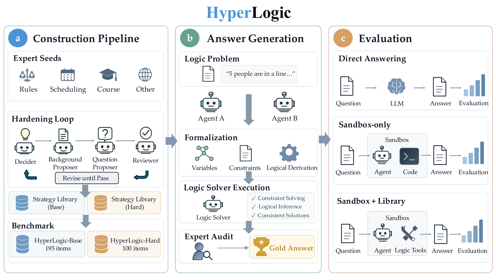

<p align="left">
    <a href="README.md">English</a>&nbsp;｜&nbsp;中文
</p>
<br>

<p align="center">
  <br>
</p>

<h1 align="center">HyperLogic: A Hard, Forward-Authored Chinese Logical Reasoning Benchmark with Execution-Derived Answers</h1>

<div align="center">

[](#-许可证)
&nbsp;&nbsp;
[](https://arxiv.org/abs/2605.19597)
&nbsp;&nbsp;
[](https://huggingface.co/datasets/tencent/HyperLogic)
&nbsp;&nbsp;
[](#-概览)
&nbsp;&nbsp;
[](#-排行榜)
&nbsp;&nbsp;
[](#-数据格式)
&nbsp;&nbsp;
[](#-快速开始)

</div>

<p align="center">
    📄&nbsp;<a href="https://arxiv.org/abs/2605.19597"><b>论文</b></a>&nbsp;&nbsp;|&nbsp;&nbsp;
    🤗&nbsp;<a href="https://huggingface.co/datasets/tencent/HyperLogic"><b>数据集</b></a>&nbsp;&nbsp;|&nbsp;&nbsp;
    🚀&nbsp;<a href="#-快速开始"><b>快速开始</b></a>&nbsp;&nbsp;|&nbsp;&nbsp;
    📮&nbsp;<a href="#-评测你的模型"><b>评测你的模型</b></a></p>

---

## 🔥 新闻

- **2026.10.28**：💻 本仓库与 [Hugging Face 数据集](https://huggingface.co/datasets/tencent/HyperLogic) 公开，包括三层各约 30% 的题目及标准答案、直接作答提示词与判分脚本，以及完整的 Hard 层 agent 评测（两种沙盒条件、原样题面和逻辑建模库）。
- **2026.10.02**：🎉 论文以 HyperLogic 为题发布于 arXiv（arXiv:2605.19597 第 2 版）：HyperLogic-Base 含 195 题、922 小问，HyperLogic-Hard 含 100 题，并给出 7 个前沿模型的评测结果。[[论文]](https://arxiv.org/abs/2605.19597)

## 📋 目录

- [概览](#-概览)
- [排行榜](#-排行榜)
- [主要发现](#-主要发现)
- [开源内容](#-开源内容)
- [快速开始](#-快速开始)
- [数据格式](#-数据格式)
- [仓库结构](#-仓库结构)
- [评测你的模型](#-评测你的模型)
- [许可证](#-许可证)
- [引用](#-引用)
- [联系我们](#-联系我们)

## 📄 概览

现有逻辑推理基准主要考察模型能否直接答对推理题，其中不少已经拉不开前沿模型的差距。从形式化结构反向生成文本的基准，答案虽然好算，却在题目写出之前就把形式化定死了。HyperLogic 采用**正向构造**：先写题目，再通过执行题目的形式化模型得出答案。

构造流程把出题和求答案分开。多智能体工作流对受过逻辑训练的本科生撰写的中文种子题进行加难，**全程不求解**。随后，来自不同模型家族的两个智能体各自独立地把每道完成的题翻译成可执行的有限域模型，由逻辑求解器得出答案。编码与答案在人类专家监督下经过分层的、智能体辅助的裁决；只有两套修正后的编码得出一致答案的题才会发布。搜索由求解器完成，因此题目可以比构造它们的模型更难，而每个答案都可执行、可审计。

<p align="center">
  
</p>

*HyperLogic 概览。**(a)** 四角色智能体循环借助分层策略库对种子题加难。**(b)** 两套独立形式化经求解器给出答案，供分层裁决。**(c)** 两层都做直接作答评测；Hard 还评测沙盒 agent，分为提供与不提供逻辑建模库两种条件。*

**数据规模**：Seed 228 题 · Base 195 题、922 小问 · Hard 100 题 · 7 个前沿模型 · 每个模型每种条件 3 次 rollout · 每个标准答案都由两套一致的独立形式化经求解器得出

**三个层级**：
- **HyperLogic-Seed**：228 道单问种子题，由修过逻辑课程的本科生撰写。和现有基准一样，Seed 几乎区分不了前沿模型：7 个模型彼此相差不到 5.9 分。
- **HyperLogic-Base**：195 道题，每道题是一段共享背景（约 3,300 字）加平均 4.7 个小问，所有小问都答对才算整题正确。前沿模型仍能直接作答，Base 的作用是把它们区分开。
- **HyperLogic-Hard**：100 道单问题，搜索空间更大、耦合更紧（背景约 8,700 字），直接求解已不现实。Hard 还评测 agent 在代码沙盒中编程求解的能力，分为提供与不提供我们的逻辑建模库两种条件。

## 🏆 排行榜

完整基准上的准确率（%），取三次 rollout 的均值 ± 标准差，所有模型使用最高推理档位。**Base 整题**要求所有小问都答对。**沙盒**为 agent 提供代码沙盒；**+ 建模库**再额外提供逻辑建模库。每列最优加粗。

| 排名 | 模型 | Seed | Base 整题 | Base 小问 | Hard 直答 | Hard 沙盒 | Hard + 建模库 |
|:---:|---|---:|---:|---:|---:|---:|---:|
| 1 | GPT-5.6 Sol | **89.8** ± 3.7 | **77.6** ± 0.6 | **92.6** ± 0.2 | 13.7 ± 5.9 | 40.3 ± 4.2 | 45.7 ± 2.1 |
| 2 | Claude Opus 5 | 86.5 ± 0.7 | 74.2<sup>†</sup> ± 2.7 | 88.9<sup>†</sup> ± 0.7 | **15.6**<sup>†</sup> ± 1.8 | **55.7** ± 3.2 | **57.0** ± 2.6 |
| 3 | Kimi K3 | 88.6 ± 0.0 | 57.9 ± 1.8 | 81.6 ± 1.8 | 4.0 ± 0.0 | 41.3 ± 1.5 | 43.0 ± 8.9 |
| 4 | Grok 4.6 | 87.0 ± 1.8 | 52.5 ± 4.1 | 82.9 ± 0.7 | 12.0 ± 1.0 | 39.3 ± 1.5 | 38.3 ± 2.1 |
| 5 | DeepSeek V4 Pro | 83.9 ± 1.7 | 51.8 ± 1.5 | 81.2 ± 1.2 | 9.3 ± 1.2 | 26.0 ± 5.6 | 20.0 ± 1.7 |
| 6 | GLM-5.3 | 87.3 ± 0.9 | 45.6 ± 3.2 | 67.2 ± 4.9 | 3.0 ± 1.0 | 20.7 ± 0.6 | 31.3 ± 5.1 |
| 7 | Doubao Seed 2.1 Pro | 85.8 ± 0.7 | 44.6 ± 2.2 | 73.2 ± 1.0 | 5.0 ± 1.0 | 26.0 ± 1.0 | 33.7 ± 0.6 |

<sup>†</sup>不计模型 API 服务拒答的题。Grok 4.6 使用 `xhigh`，其余模型使用 `max`。按 Base 整题准确率排名。

## 💡 主要发现

- **Base 难且有区分度。** 在 7 个现有逻辑基准中的 5 个上，三个前沿模型相差不超过 3 分，Seed 也是如此（83.9–89.8%）。到了 Base，每个模型比 Seed 至少掉 12 分，7 个模型拉开 33.0 分（44.6–77.6%）。
- **推理更长不等于更准。** Base 上每题推理长度的中位数从 15.2k 到 52.7k token 不等，与准确率并不对应：准确率最高的两个模型所用 token 不到 GLM-5.3 的一半，而 GLM-5.3 在 585 次运行中有 99 次耗尽 131k token 上限仍未给出可解析的答案。
- **各模型的错误来源相同，可能性空间的大小把它们拉开。** 多数模型的错误率随标准答案规模增大而上升；排名前两位的模型反而在较大的一半上错得**更少**。
- **Hard 基本超出直接作答能力，沙盒有帮助但解决不了问题。** 直接作答没有模型超过 16%。代码沙盒让每个模型提升 16.7–40.1 分，但最好成绩也只有 55.7%（提供建模库时为 57.0%）。
- **逻辑建模库并不总能带来提升。** 加入建模库后，Hard 准确率变化在 −6.0 到 +10.6 分之间：五个模型提升，两个下降。要用好它，模型得先理解它的建模语言。
- **模型倾向写普通 Python，而不是调用求解器。** 只给沙盒时，7 个模型中有 6 个主要写普通 Python：枚举候选赋值，再用手写规则过滤。

## 📦 开源内容

一个基准的题目一旦全部公开、进入训练数据，就不再衡量推理能力。因此我们从**每层固定均匀抽取 30% 的题目**公开，连同运行评测所需的全部内容，其余题目保持私有：

- **公开题目及标准答案**：`data/seed.json`、`data/base.json`、`data/hard.json`。按整题抽样，被选中的 Base 题的全部小问都保留在一起。
- **直接作答提示词与语义判分**：`evaluate.py` 生成论文所用的提示词，并用检查语义等价的 LLM judge 判分，输出整题准确率和小问准确率。
- **完整的 Hard agent 评测**：`hard_agent/` 包含每道公开 Hard 题在两种条件下的原样题面、工作区构建脚本、Docker 运行器、答案收集与多轮汇总脚本，以及提供给建模库条件的完整 11 个模块的 `translation` 库和 `MANUAL.md`。
- **抽样流程**：`build_public_subset.py` 与 `selection_manifest.json`，附完整题库的 SHA-256 承诺，可供审计拆分是否如实。

| 层级 | 全部题数 | 公开题数 | 公开小问数 | 私有题数 |
|---|---:|---:|---:|---:|
| Seed | 228 | 69 | 69 | 159 |
| Base | 195 | 59 | 274 | 136 |
| Hard | 100 | 30 | 30 | 70 |

其余 70% 的题目，以及**全部**题目（包括公开题）经专家验证的形式化翻译，均不公开。公开子集上的成绩无法复现上面完整基准的数字；如需在完整基准上评测，请见[评测你的模型](#-评测你的模型)。

## 🚀 快速开始

需要 Python 3.10 或更高版本。`evaluate.py` 只用标准库；Hard 建模库的可选求解器后端列在 `hard_agent/requirements.txt` 中。

### 1. 生成提示词

```bash
python evaluate.py prompts --tier seed --output seed_prompts.jsonl
python evaluate.py prompts --tier base --output base_prompts.jsonl
python evaluate.py prompts --tier hard --output hard_prompts.jsonl
```

每行包含 `id` 和直接作答的 `prompt`。把每条提示词发给待测模型，然后每题保存一条 JSONL 记录：

```json
{"id": 12, "answers": ["第1小问答案", "第2小问答案"]}
```

`answers` 的数量和顺序必须与 `question[]` 一致；Seed 的 ID 是字符串。答案也可以是 JSON 标量、数组或对象，判分前会序列化为 JSON 文本。模型拒答记为 `{"id": 12, "status": "refusal"}`。缺失和无效的预测记为错误；拒答单独统计，不计入分母，与论文口径一致。

### 2. 判分

论文使用判断语义等价的 LLM judge，而不是字符串完全匹配；`evaluate.py` 对同一题的所有小问一起判分。接口需兼容 OpenAI Chat Completions：

```bash
export OPENAI_BASE_URL="https://YOUR-ENDPOINT/v1"
export OPENAI_API_KEY="YOUR-KEY"
python evaluate.py score --tier base --predictions base_predictions.jsonl \
  --judge-model YOUR-JUDGE-MODEL --output base_scores.json
```

判分脚本输出整题准确率（所有小问都对）和小问准确率，并生成 `*.verdicts.jsonl` 审计文件。若已有判定结果、不想调用 API，可用 `--verdicts verdicts.jsonl` 代替 `--judge-model`，每题一行，例如 `{"id": 12, "matches": [true, false]}`。有效预测缺少判定时会直接报错，而不是悄悄记错。`--judge-repeats 2` 可复现 Hard agent 条件下的重复判分及一致率报告。

### 3. 评测 Hard agent

条件 `c2` 只给 agent 任务文件和题面；`c3` 额外提供完整的 `translation` 库和 `MANUAL.md`。两种条件使用相同的 agent 模型和设置。在仓库根目录下准备隔离的工作区，每个 agent 在独立的 Docker 容器中运行，收集其 `answer.json`，再对每轮 rollout 判分：

```bash
python hard_agent/prepare_workspaces.py --output-root /tmp/hyperlogic-agent --rollouts 3

for condition in c2 c3; do
  python hard_agent/run_agents.py \
    --workspaces /tmp/hyperlogic-agent --condition "$condition" \
    --image YOUR_AGENT_IMAGE --env YOUR_API_KEY_VAR --concurrency 4 \
    -- YOUR_AGENT_COMMAND task.md

  for rollout in 1 2 3; do
    python hard_agent/collect_predictions.py \
      --workspaces /tmp/hyperlogic-agent --condition "$condition" \
      --rollout "$rollout" --output "/tmp/${condition}-r${rollout}.jsonl"
    python evaluate.py score --tier hard \
      --predictions "/tmp/${condition}-r${rollout}.jsonl" \
      --judge-model YOUR-JUDGE-MODEL --judge-repeats 2 \
      --output "/tmp/${condition}-r${rollout}-scores.json"
  done

  python hard_agent/summarize_rollouts.py \
    "/tmp/${condition}-r1-scores.json" \
    "/tmp/${condition}-r2-scores.json" \
    "/tmp/${condition}-r3-scores.json" \
    --output "/tmp/${condition}-summary.json"
done
```

Docker 镜像需包含你的 agent CLI 及其依赖。每个 agent 必须在工作区写出 `answer.json`，以 `case/questions.json` 中的题目 ID 为键。运行器默认每个工作区限 2 CPU、10 GB 内存、3 小时。**每个容器只挂载一个准备好的工作区**：直接在仓库目录里运行 agent，它能读到公开的标准答案文件。工作区内容、答案格式和运行器参数详见 [`hard_agent/README.md`](hard_agent/README.md)。

## 🗂️ 数据格式

`data/` 下每个文件都是题目列表（JSON）。每道题包含 `id`、`background`、一一对应的 `question[]` 与 `answer[]` 数组，以及可选的 `title`。Seed 题只有一个小问，ID 为由内容生成的 `seed-...`；Base 和 Hard 保留原整数 ID。文件中不包含形式化翻译、作者信息或私有题目。

`build_public_subset.py` 对每层独立做无放回均匀抽样，随机数生成器为 `random.Random("2027:<tier>")`，抽取 `ceil(0.30 × 全部题数)` 道。抽样前完整题库按题目 ID 排序，选中的题保持该顺序。`selection_manifest.json` 记录了抽样方法、每层完整题库的 SHA-256 承诺和公开子集的哈希。

公开题目同时发布在 Hugging Face 上，分为 `seed`、`base`、`hard` 三个配置，各含一个 `test` 划分：

```python
from datasets import load_dataset

base = load_dataset("tencent/HyperLogic", "base", split="test")   # also "seed" and "hard"
```

## 📁 仓库结构

```
hyperlogic/
├── data/                      公开题目及标准答案
│   ├── seed.json              69 题
│   ├── base.json              59 题 · 274 小问
│   └── hard.json              30 题
├── evaluate.py                直接作答提示词与语义等价判分
├── hard_agent/                Hard agent 评测
│   ├── payloads/{c2,c3}/      每道公开 Hard 题的原样 task.md 和题面文件
│   ├── library/translation/   提供给 c3 的逻辑建模库（Z3、BDD、SAT、Ganak 后端）
│   ├── MANUAL.md              提供给 c3 的建模库手册
│   ├── prepare_workspaces.py  为每轮 rollout 构建隔离工作区
│   ├── run_agents.py          带资源限制的 Docker 运行器
│   ├── collect_predictions.py 把 answer.json 汇总为预测文件
│   └── summarize_rollouts.py  多轮 rollout 的均值与波动
├── build_public_subset.py     30% 抽样流程
├── selection_manifest.json    抽样规则与题库哈希承诺
└── assets/                    本 README 用到的图片
```

## 📮 评测你的模型

HyperLogic 留出的 70% 题目不公开，以保证其评测结果不受数据污染。如需在完整基准上评测模型，请[联系我们](#-联系我们)，我们会按排行榜相同的流程运行评测。

## 📜 许可证

本仓库采用 [Apache-2.0 许可证](LICENSE)。

## 📝 引用

```bibtex
@article{zhang2026hyperlogic,
  title   = {HyperLogic: A Hard, Forward-Authored Chinese Logical Reasoning
             Benchmark with Execution-Derived Answers},
  author  = {Zhang, Ming and Peng, Qiyuan and Wei, Yinxi and Shen, Yujiong and
             Tan, Kexin and Wang, Yuhui and Xiang, Zhenghao and Ye, Junjie and
             Yin, Zhangyue and Xi, Zhiheng and Dou, Shihan and Wang, Weikang and
             Zhang, Yuhao and Gui, Tao and Yang, Ruizhi and Zhang, Qi and
             Huang, Xuanjing and Chen, Alex and Pan, Maxm},
  journal = {arXiv preprint arXiv:2605.19597},
  year    = {2026}
}
```

## 📧 联系我们

如有问题或评测需求，请提交 issue，或发邮件给张明（mingzhang23@m.fudan.edu.cn）或 Maxm Pan（maxmpan@tencent.com）。

<div align="center">
<sub>HyperLogic · 复旦大学 · 腾讯混元团队</sub>
</div>
